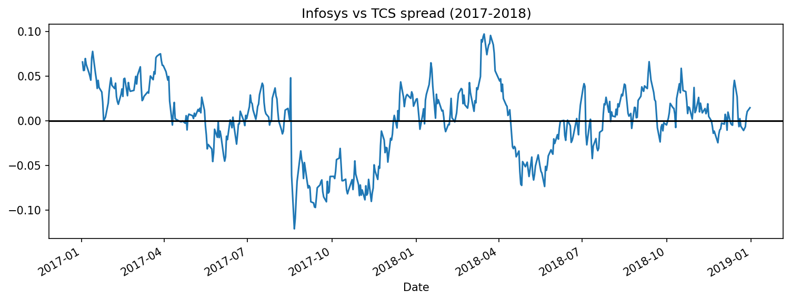
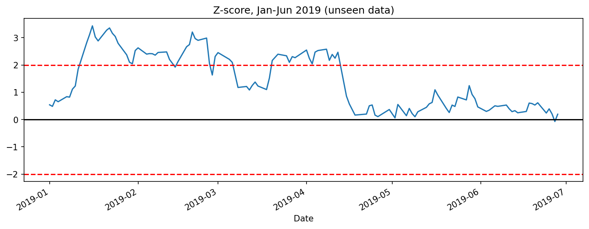
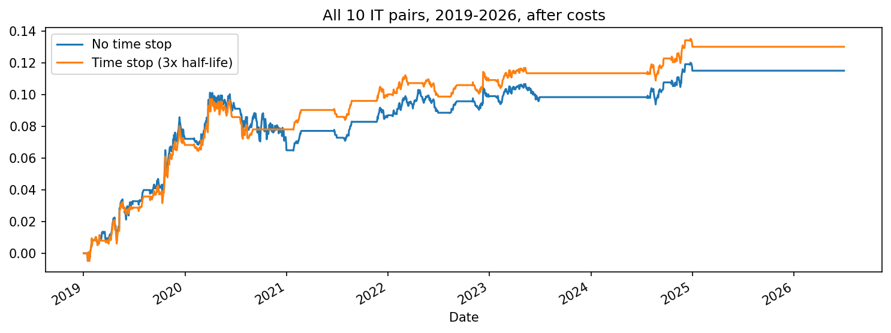
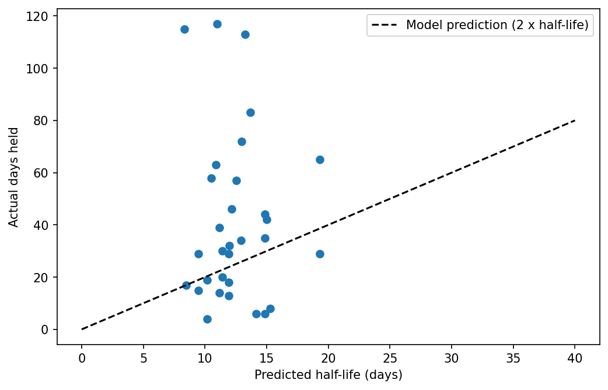

# Pairs Trading on Indian IT Stocks with the Ornstein–Uhlenbeck Process

A rolling, out-of-sample backtest of a mean-reversion pairs trading strategy on five large-cap NSE IT stocks (2019–2026). Pairs are selected with cointegration tests, the spread is modelled as an Ornstein–Uhlenbeck (OU) process, and the OU half-life is used both to understand the trade and to set a time stop.

**Headline result:** an equal-weight portfolio of all 10 pairs returned **+13.0% with a Sharpe ratio of 0.88** after costs (with a 3× half-life time stop), versus +11.5% / 0.67 without it. Most of the profit came in 2019–2021; the edge faded after that.

---

## The idea

Two companies in the same business (e.g. Infosys and TCS) tend to move together. When the gap between them gets unusually wide, a pairs trader bets it will close: sell the expensive one, buy the cheap one, and exit when the gap returns to normal.

The gap (the *spread*) is modelled as an OU process:

$$dX_t = \theta(\mu - X_t)\,dt + \sigma\,dW_t$$

- **θ** – how strongly the spread is pulled back to its mean
- **μ** – the long-run average spread
- **Half-life = ln(2)/θ** – the expected time for half of any gap to close

## Data

- **Stocks:** TCS, Infosys, Wipro, HCL Technologies, Tech Mahindra (`.NS` tickers)
- **Source:** Yahoo Finance via `yfinance`, daily closes adjusted for splits and bonus issues
- **Period:** Jan 2017 – Sep 2026 (2,409 trading days), analysed as log prices
- **Checks:** three single-day moves above 15% were investigated and kept as real events — Infosys (22 Oct 2019, whistleblower allegations), Tech Mahindra (23 Mar 2020, COVID crash), Wipro (15 Jul 2020, results)

## Method

1. **Rolling windows (no look-ahead).** Estimate on a 2-year *formation* window, trade the next 6 months, roll forward 6 months. Every parameter used for trading comes only from the past. This gives 15 trading windows from Jan 2019 to Jun 2026.
2. **Pair selection.** Engle–Granger cointegration test (`statsmodels.coint`) on each of the 10 pairs in every formation window. A pair is only traded in windows where p < 0.05, so pairs switch on and off as relationships form and break.
3. **Spread.** Regress log A on log B to get the hedge ratio *h*: spread = log A − h·log B − c.
4. **OU estimation.** Regress the daily change in spread on yesterday's spread level (Δsₜ = a + b·sₜ₋₁). Then θ = −ln(1+b), μ = −a/b, and the equilibrium standard deviation σ is taken from the regression residuals.
5. **Signals.** z = (spread − μ)/σ. Enter when |z| > 2, exit when |z| < 0.5. Positions are taken the day *after* a signal. Any open trade is closed at the end of each window.
6. **Costs.** 0.2% charged on every entry and every exit (both legs combined), as an approximation of brokerage, taxes and slippage.
7. **Time stop.** Exit any trade held longer than 3× the estimated half-life, and block re-entry until the spread returns inside the entry band.

## Worked example: Infosys vs TCS

Formation window 2017–2018:

| | |
|---|---|
| Cointegration p-value | 0.006 |
| Hedge ratio | 0.771 |
| θ (per day) | 0.064 |
| Half-life | 10.9 trading days |

Applied to unseen data (Jan–Jun 2019), the z-score crossed +2 in mid-January. The trade (sell Infosys, buy TCS) was held for **63 days** and made **+10.2% after costs** — profitable, but far slower than the 11-day half-life suggested.

## Results

### Portfolio (equal weight across all 10 pairs, 2019–2026, after costs)

| Setting | Profit % | Sharpe | Trades | Longest trade (days) |
|---|---|---|---|---|
| No time stop | 11.5 | 0.67 | 31 | 117 |
| Time stop 2× half-life | 9.0 | 0.69 | 39 | 39 |
| **Time stop 3× half-life** | **13.0** | **0.88** | 35 | 58 |
| Time stop 4× half-life | 12.8 | 0.84 | 33 | 65 |

### By pair (no time stop)

| Pair | Profit % | Max drawdown % |
|---|---|---|
| Infosys – TCS | 58.2 | −16.1 |
| HCL – TCS | 37.9 | −20.7 |
| HCL – Infosys | 12.4 | −8.8 |
| Tech Mahindra – Wipro | 8.0 | −11.3 |
| TCS – Tech Mahindra | 6.2 | −5.2 |
| HCL – Tech Mahindra | 0.3 | −12.1 |
| Infosys – Wipro | −7.9 | −14.4 |
| Infosys – Tech Mahindra, HCL – Wipro, TCS – Wipro | 0.0 | never traded |

### Robustness (no time stop)

| Setting | Profit % | Sharpe |
|---|---|---|
| Baseline (entry z = 2, cost 0.2%) | 11.5 | 0.67 |
| Double costs (0.4%) | 10.3 | 0.60 |
| Enter earlier (z = 1.5) | 8.8 | 0.46 |
| Enter later (z = 2.5) | 12.7 | 0.83 |

The strategy stays profitable across all settings, and doubling costs barely matters because it trades rarely. z = 2 is kept as the main setting; z = 2.5 was not selected after the fact.

## Does the half-life predict holding time?

Entering at |z| = 2 and exiting at |z| = 0.5 means waiting for 75% of the gap to close, which in theory takes about **2 half-lives**.

- **Median holding time was 32 days, versus a model prediction of 23.8** (2 × median half-life). Trades took about 35% longer than the OU model implied.
- Three trades lasted ~113–117 days and were likely closed by the window ending, not by the spread reverting.
- Estimated half-lives all fell between 8 and 19 days, so the model could not separate fast pairs from slow ones.

This is what motivated the time stop: the half-life is a useful rough guide but systematically optimistic, and the long trades are where the risk sits.

## What I learned / limitations

- **The edge decayed.** Most of the profit came in 2019–2021. Infosys–TCS stopped being cointegrated from 2023 (p-values 0.18–0.83), and the strategy correctly sat out rather than losing money — but a real fund would have had idle capital for years.
- **Event risk dominates.** A single news-driven window (Infosys, Oct 2019) produced a large share of Infosys–TCS profits; the 2017 Infosys CEO resignation shows the opposite case, where a gap took months to close.
- **Small sample.** ~35 trades is not enough to treat the Sharpe improvement from the time stop (0.67 → 0.88) as precise. The clearer benefit is that it halved the worst holding period.
- **Simplified returns.** Profit is the sum of daily spread changes (roughly the % return on the long-or-short leg of stock A), not compounded, and ignores margin.
- **Implementation in India.** Cash equities can't be shorted overnight, so the short leg would need stock futures, with roll costs and lot sizes not modelled here.
- **Universe bias.** The five stocks were chosen as today's large-cap IT names, which introduces some survivorship bias.

## Possible extensions

- Kalman filter for a time-varying hedge ratio
- More sectors (private banks, FMCG) for more trades and diversification
- Johansen test for three-stock baskets
- Maximum-likelihood OU estimation, compared with OLS

## How to run

Open `ou_pairs_trading.ipynb` in Google Colab and run all cells. Dependencies: `yfinance`, `pandas`, `numpy`, `statsmodels`, `matplotlib`.

---

*Author: Atharva*
